

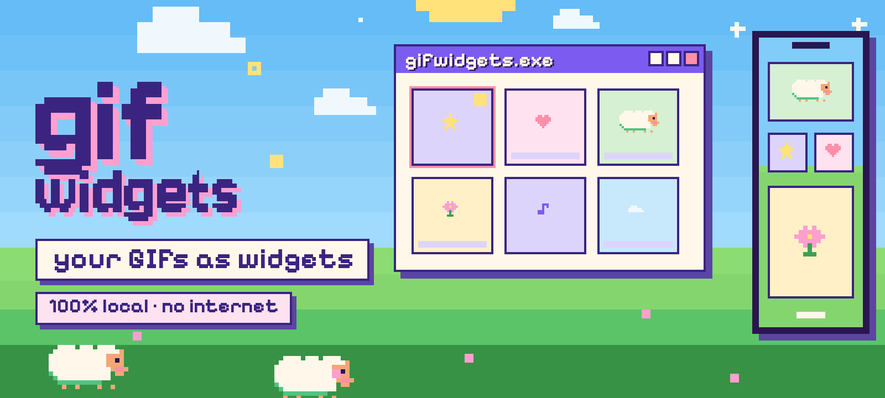

  <b>Turn your GIFs into animated widgets for your Android home screen.</b> 
  No internet, no accounts, no ads, and the lowest battery cost I could get.

    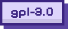 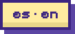 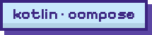

  <a href="https://github.com/KitsukiLove/GifWidgets/releases/latest"><b>⬇ Download the APK</b></a> &nbsp;·&nbsp;
  <a href="README.md">Español</a>

  <a href="#what">What it is</a> &nbsp;·&nbsp;
  <a href="#gallery">Gallery</a> &nbsp;·&nbsp;
  <a href="#install">Install</a> &nbsp;·&nbsp;
  <a href="#features">Features</a> &nbsp;·&nbsp;
  <a href="#privacy">Privacy</a> &nbsp;·&nbsp;
  <a href="#battery">Battery</a> &nbsp;·&nbsp;
  <a href="#develop">Develop</a> &nbsp;·&nbsp;
  <a href="#credits">Credits</a>

 

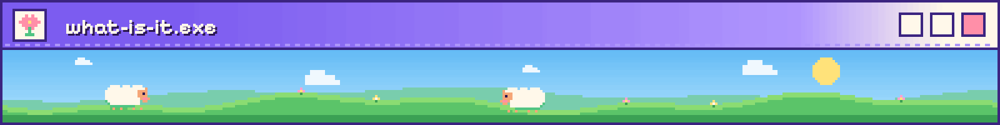

GifWidgets keeps your GIFs in a private library and puts them on your home screen as **animated widgets**. It optimizes each GIF when you import it (WebP frames) so the widget is smooth and costs very little, and lets you tweak how every widget looks. It is made for pixel art and glowing banners on black, but any GIF works.

- **Add a GIF and you're done:** import it, share it from another app or pick it from a widget, and the app saves it already optimized with sensible defaults. No need to open the editor.
- **Self-configuring widgets:** on Android 12 or later a new widget shows your latest animation right away; change it later if you like.
- **Three sizes** (2×2, 4×2 and 4×4), all resizable, with lots of per-widget settings.
- **No-AI editor:** remove backgrounds, crop, reorder frames and check the widget's memory use before saving.
- **Automatic GIF rotation** per widget, from every 15 minutes up to every 24 hours.
- **Library with favorites and collections,** search, filters, a compact list view and a ZIP backup.
- **Battery first:** the launcher moves the widget, not the app; there is a master switch, a pause on battery saver and a night schedule.
- **Privacy first:** it has no internet permission. Nothing leaves your phone.
- **[KixKi Store](https://github.com/KitsukiLove/KixKi-Store) look:** Pixel and Colina XP styles, eight seasons, music generated on your phone and Kixki, the guide sheep. In Spanish and English.

| At a glance | |
|---|---|
| **Android** | 8.0 or later (API 26). Tested on a Google Pixel 9. |
| **Widgets** | 2×2, 4×2 and 4×4, resizable |
| **Permissions** | None for data or network. Only those of the optional "Max quality" mode (see [Privacy](#privacy)) |
| **Internet** | Neither used nor declared |
| **Languages** | Spanish (default) and English |
| **License** | GNU GPL v3.0, F-Droid compatible |

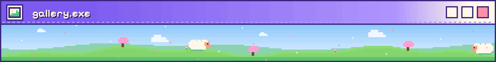

<table>
<tr><td align="center" valign="top" width="25%">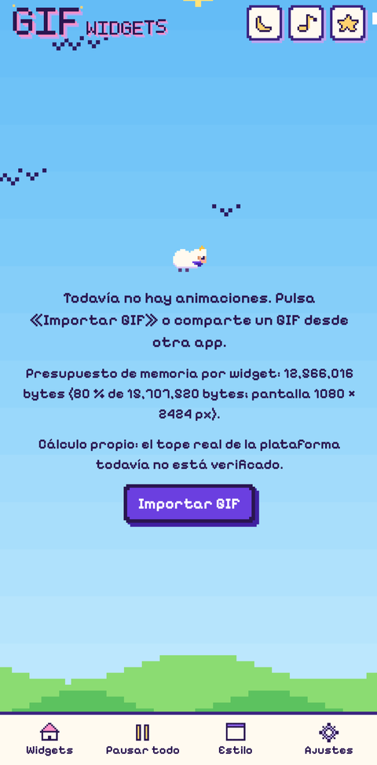</td><td align="center" valign="top" width="25%">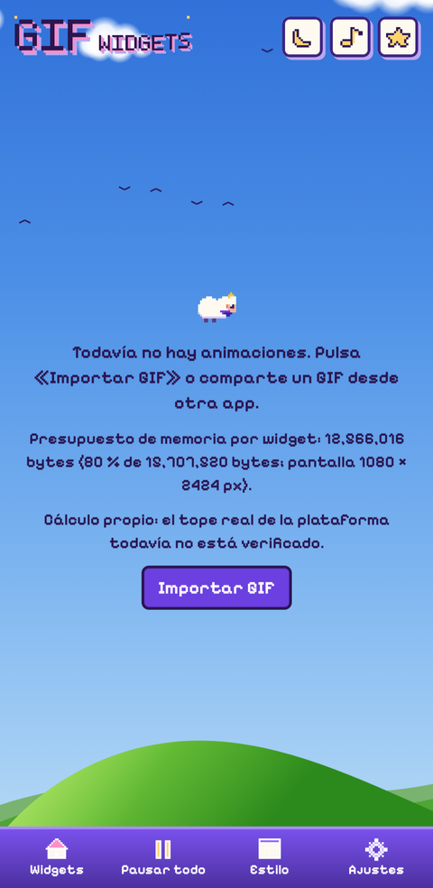</td><td align="center" valign="top" width="25%">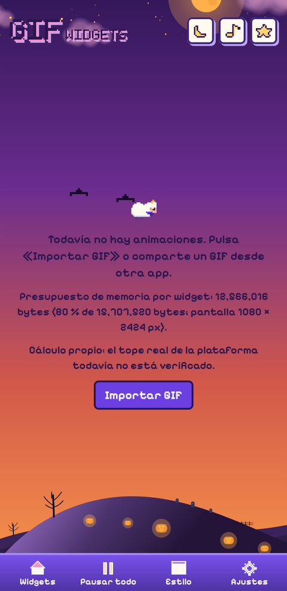</td><td align="center" valign="top" width="25%">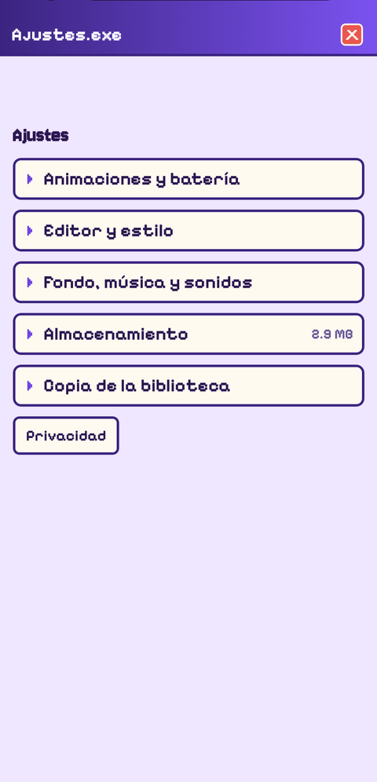</td></tr>
<tr><td align="center">Pixel style</td><td align="center">Colina XP</td><td align="center">Halloween season</td><td align="center">Settings</td></tr>
</table>

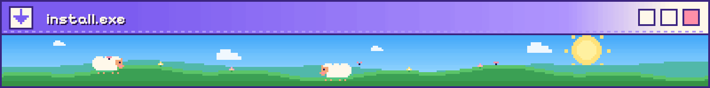

**Download**

<table>
<tr><td align="center" valign="top" width="50%">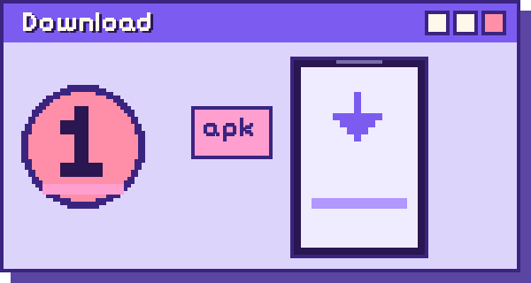 Open <a href="https://github.com/KitsukiLove/GifWidgets/releases/latest"><b>Releases</b></a> in your phone's browser and download the <code>GifWidgets-….apk</code> file of the latest version.</td><td align="center" valign="top" width="50%">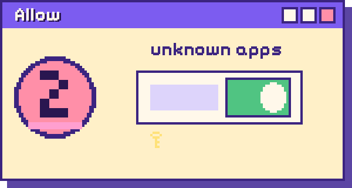 Open it. Android will ask you to allow "install unknown apps" for your browser or file manager: allow it just for this step.</td></tr>
<tr><td align="center" valign="top" width="50%">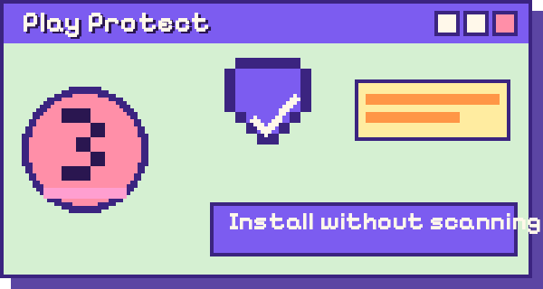 If a <b>Play Protect</b> notice appears ("App scan recommended"), it is not an error: tap <b>"Install without scanning"</b> (the small text) or <b>"Scan app"</b>.</td><td align="center" valign="top" width="50%">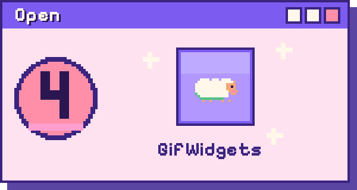 Open GifWidgets. That notice shows up for any app that doesn't come from a store.</td></tr>
</table>

> **Before updating:** every release APK is signed with a different debug key, so Android won't install a version **over** another one: you have to uninstall the old one first, which deletes your library. Before that, use **Settings → Library backup → Export** to save a ZIP, then **Import** it in the new version.

**First steps**

<table>
<tr><td align="center" valign="top" width="33%">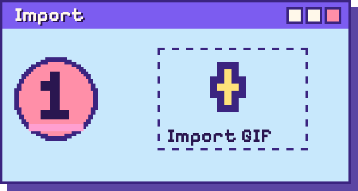 Tap <b>Import GIF</b>, or share a GIF from another app with "Add to GifWidgets".</td><td align="center" valign="top" width="33%">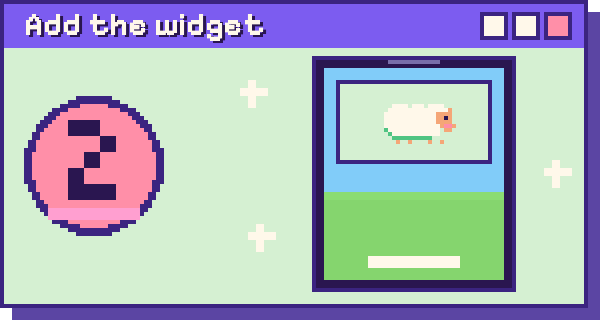 Long-press your home screen → <b>Widgets</b> → <b>GifWidgets</b> and pick a size. <b>Add to home screen</b> on a GIF's card works too.</td><td align="center" valign="top" width="33%">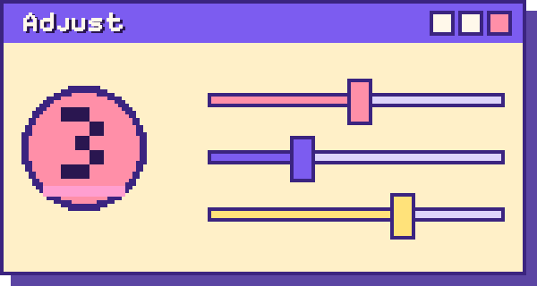 Long-press the widget → configure. Everything has defaults, so this is optional.</td></tr>
</table>

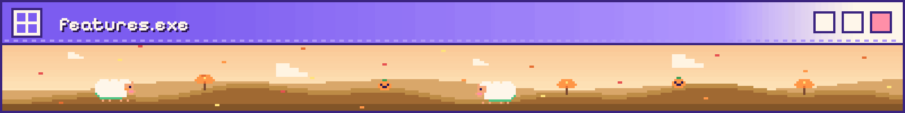

<table>
<tr><td align="center" valign="top" width="33%">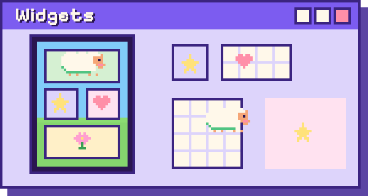 2×2, 4×2 and 4×4 with framing, corners, borders and tap action your way.</td><td align="center" valign="top" width="33%">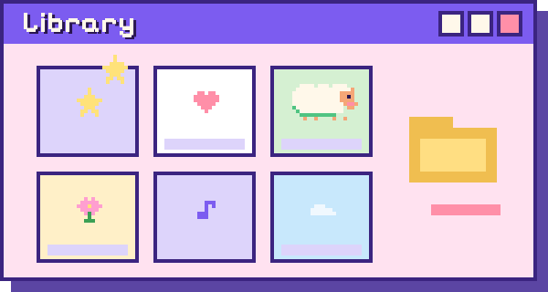 Favorites, collections, search and a list view.</td><td align="center" valign="top" width="33%">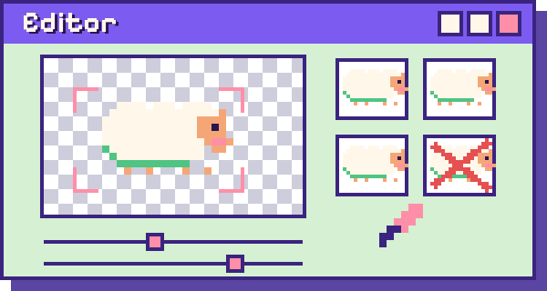 Remove backgrounds, crop and check memory before saving.</td></tr>
<tr><td align="center" valign="top" width="33%">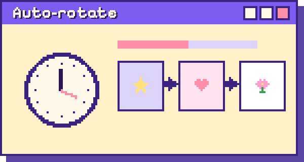 Switches GIF by itself, every 15 min up to every 24 h.</td><td align="center" valign="top" width="33%">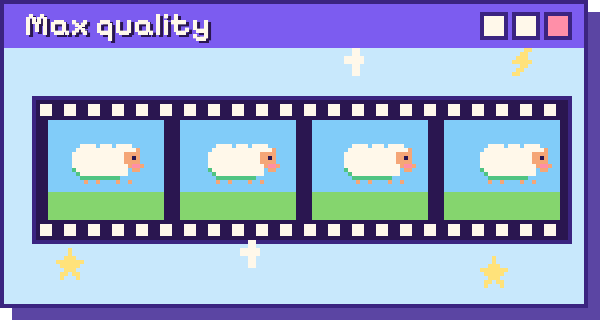 Frame by frame with no memory limit (optional).</td><td align="center" valign="top" width="33%">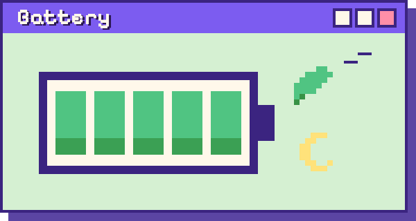 Master switch, battery saver pause and night schedule.</td></tr>
<tr><td align="center" valign="top" width="33%">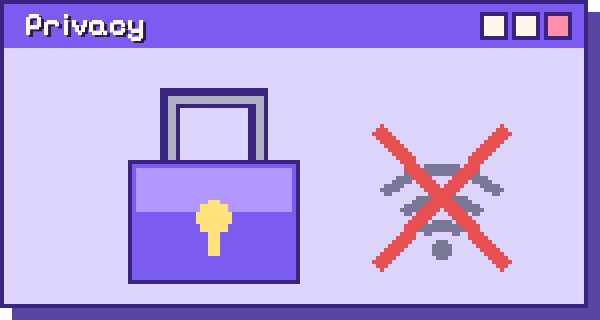 No internet: everything stays on your phone.</td><td align="center" valign="top" width="33%">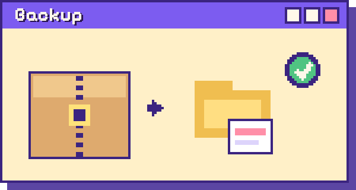 Export and import your library as a ZIP.</td><td align="center" valign="top" width="33%">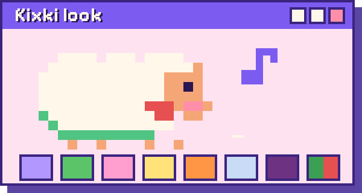 Pixel and Colina XP styles, 8 seasons, music and Kixki.</td></tr>
</table>

**Every detail, by topic:**

<b>Widgets</b>: sizes, looks and tap action

- **Sizes:** GIF 2×2, GIF 4×2 and GIF 4×4, all resizable.
- **Framing:** automatic (fills the widget cropping at most a third of the image), fit, fill or center, plus zoom.
- **Look:** corners, border and its color, background color and opacity, inner padding, brightness and opacity of the animation, and speed.
- **Optional pause button,** in the corner you choose.
- **When you tap the widget:** toggle the animation, open the app, pause or resume **all** widgets, go to the next animation in the list, or play once (experimental).
- **Pick a GIF from the widget,** with a prompt to name it before it is added.
- **Real-size preview** and **copy the look** of another widget.
- **Collapsible sections** with a reset button in each one, and a preview of what will be used (frames, pixels and speed).
- **Lock screen:** widgets are also offered on the lock screen widgets page (Android 16 QPR2 or later). Turn it on in Settings → Display & touch → Lock screen → "Widgets on lock screen".
- **Widget picker:** on Android 15 or later the preview shows your latest animation.
- On Android 11 or earlier, placing a widget opens its settings.

<b>Library</b>: import and organize

- **Import** with the button, with "Share" from another app (one or several GIFs) or with "Pick GIF" inside a widget.
- **Name before adding:** the app suggests one from the file and you can change it, or accept the same choice for every file in a multiple import.
- **Favorites** (shown first) and **collections** to group them, with filters by favorites or by collection.
- **Search,** sort by newest, name or size, and filters for transparency and for optimized ones.
- **Card view or compact list view.**
- **Multi-select** to duplicate, delete or move to a collection.
- Rename, duplicate, delete (it warns if a widget is using the GIF) and see how much space each animation takes.
- **Import limits:** up to 50 MB, 4096 px per side (about 6 million pixels) and 400 frames. The file is treated as untrusted and validated before use.

<b>Editor</b>: simple and Advanced mode

- **Always re-edited from the original,** so quality is never lost twice (unless you delete the original in Settings).
- **Remove the background without AI:** keep the GIF as is, **key color** with an eyedropper, tolerance, only from the edges, edge softening and halo removal; or **black to transparent** for glows, stars and neon on black.
- **Frames:** start and end wherever you like, delete and restore frames, ping-pong, keep 1 of every N and choose the rest frame.
- **Cropping,** manual or automatic to the visible content.
- **Speed and size:** frames per second, max size, sharp pixels (no smoothing when scaling down) and lossy or lossless WebP.
- **Widget memory meter** with auto-fit, and a memory saver (RGB_565) when there is no transparency.
- Preview on a checkerboard, white, black or a color, and a button to **see the original**.
- Simple mode shows the essentials; **Advanced** opens the rest.

<b>Automatic GIF rotation</b>

Each widget can rotate by itself through the animations you choose in its list: every 15 minutes, 30 minutes, 1, 3 or 6 hours, or once a day. It uses a single inexact alarm (a 15-minute window) that does not wake the phone and keeps no service running. You can also jump to the next animation by tapping the widget.

<b>Max quality</b> (optional, per widget)

Plays the GIF frame by frame, at its own resolution and speed, from a foreground service and **without the widget memory limit**. It uses more battery and shows a notification while running; it pauses when the screen is off, at night, on battery saver or when you pause. If you deleted the original GIF, it uses the saved frames. This is the only thing that makes the app ask for permissions.

<b>Battery control and pause</b>

- **Master switch "Animations":** pauses or resumes all widgets, also from **Quick Settings** (tile) and as a widget tap action.
- **Pause on battery saver.**
- **Night schedule** you can set; on each widget you can turn it on even at night, only until that night ends.
- More in [Battery](#battery).

<b>Backup</b>

- **Export** the library (or the animations you pick) to a ZIP, and **Import** from one. You choose where the file is saved; the ZIP is validated before anything is touched.
- **Reminder** after 30 days without a backup (and at least 3 animations). It snoozes for a week if you dismiss it.
- Google's cloud backup is turned off for the app on purpose.
- Settings also shows the **last backup** and the **storage** used, with an option to remove each animation's original GIF to save space.

<b>KixKi Store look</b>: styles, seasons, music and Kixki

- **Two styles:** **Pixel** and **Colina XP**, and light, dark or system mode.
- **Eight seasons** for the background: Classic, Valley, Spring, Summer, Autumn, Winter, Halloween and Christmas. "Automatic" follows the date. The animated background stops by itself on battery saver.
- **Music and sounds,** optional, made on your phone (no audio files). They only play while the app is open.
- **Kixki,** the guide sheep, greets you once and then leaves easy tips in a strip you can close and bring back in Settings.
- ".exe" windows, a bottom bar and a landscape backdrop, with a logo that scales with your font size.
- **Languages:** Spanish and English.

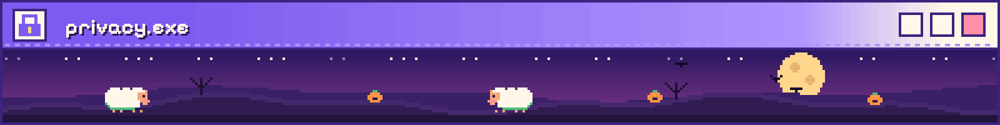

**The app sends nothing anywhere. It can't: it has no internet permission.** No accounts, no ads, no analytics, no Google Play services and no AI models.

| Permission | What for | When it is used |
|---|---|---|
| `FOREGROUND_SERVICE` and `FOREGROUND_SERVICE_SPECIAL_USE` | The foreground service of "Max quality" mode | Only while a widget is in that mode |
| `POST_NOTIFICATIONS` | That service's notification (optional) | Only in that mode |

None of them gives access to the internet or to your data, and without "Max quality" they do nothing. You can check it in the app itself (**Settings → Privacy**) or in Android Studio (`AndroidManifest.xml` → **Merged Manifest** tab).

- **Your files:** a GIF comes in only when you pick it with the system picker or share it from another app. The app does not read your gallery.
- **Where data lives:** GIFs, frames and settings are in the app's **private** storage; no other app can read them, and they are deleted on uninstall.
- **Lock screen:** if you put a widget there, its animation is visible without unlocking the phone. Choose carefully which GIF you show.
- **Sound:** music and sounds are generated on your phone; the app does not use the microphone.
- **Components:** Android and Jetpack libraries, and Kotlin. The GIF decoder and the WebP conversion are written in-house.

Full details in [`docs/PRIVACY.md`](docs/PRIVACY.md) (Spanish).

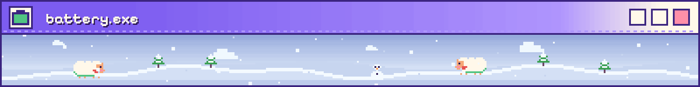

The core idea: **while the widget is moving, the app is not alive.** The launcher animates it with a `ViewFlipper`, so the app uses no CPU and keeps no process. The widgets use classic `RemoteViews` (not Glance) for exactly that reason.

| Mechanism | How it works |
|---|---|
| No permanent processes | Only short jobs when you tap, resize or add a widget |
| Master switch | Pauses everything at once; also in Quick Settings |
| Battery saver | Widgets stay still while it is on |
| Night schedule | A single inexact alarm that doesn't wake the phone |
| Automatic GIF rotation | A single inexact alarm with a 15-minute window |
| Memory | A budget per widget; if it doesn't fit, it scales down with a notice instead of failing |
| "Max quality" | The exception: it uses more battery, so it is optional and per widget |

To measure it on your phone with `adb`: [`docs/BATTERY_TESTING.md`](docs/BATTERY_TESTING.md) (Spanish).

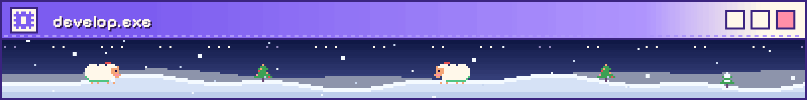

**Stack:** Kotlin, Jetpack Compose with Material 3, `RemoteViews` + `ViewFlipper` for the widgets, a single `app` module, minSdk 26 and targetSdk 36. Package: `app.gifwidgets`.

<b>Build in Android Studio</b>

1. Open the project folder with Android Studio (Windows, Mac or Linux).
2. Let Gradle sync and press **Run ▶** with your phone connected (USB debugging).

<b>Release build and APK</b>

`app/build.gradle.kts` already ships a release with R8, shrunk resources, only Spanish and English, and the debug signature (personal use, not a store signature).

- In Android Studio: **Build Variants → release**, then **Build → Generate App Bundles or APKs → Generate APKs**.
- In a terminal: `./gradlew assembleRelease` (`gradlew.bat assembleRelease` on Windows). The APK ends up in `app/build/outputs/apk/release/`.
- Test the library, the editor, a widget and Settings on that build: R8 can break things that work in debug.

**With GitHub Actions:** the [`build-apk.yml`](.github/workflows/build-apk.yml) workflow builds the APK on GitHub's servers.
- **With a version:** create a tag (`git tag v1.0 && git push --tags`) and the APK shows up under **Releases**.
- **By hand:** **Actions → Build APK → Run workflow** tab; the APK is kept as an *artifact*.

<b>Tests</b>

- Pure logic (control, widget settings, ZIP, GIF, editing, library, rotation…): `./gradlew testDebugUnitTest`.
- Manual test checklist for the phone: [`docs/PRUEBAS.md`](docs/PRUEBAS.md) (Spanish).
- Battery measurement: [`docs/BATTERY_TESTING.md`](docs/BATTERY_TESTING.md) (Spanish).

<b>Project structure</b>

Code lives in `app/src/main/kotlin/app/gifwidgets/`. Strings are in `values/` (Spanish) and `values-en/` (English).

| Folder | What is in it |
|---|---|
| `gif/` | In-house GIF decoder |
| `library/` | Library, import, favorites and collections |
| `edit/` | Editor and the optimized WebP writer |
| `memory/` | Per-widget memory budget calculation |
| `widget/` | Widgets, settings, automatic rotation and "Max quality" |
| `control/` | Master switch, battery saver, night schedule and seasons |
| `backup/` | ZIP export and import, and the reminder |
| `audio/` | Generated music and sounds |
| `ui/` | Screens and the design (Pixel and Colina XP) |

<b>Documents</b>

| File | Contents |
|---|---|
| [`docs/PRIVACY.md`](docs/PRIVACY.md) | Full privacy policy (Spanish) |
| [`docs/BATTERY_TESTING.md`](docs/BATTERY_TESTING.md) | How to measure battery (Spanish) |
| [`docs/PRUEBAS.md`](docs/PRUEBAS.md) | Manual test list (Spanish) |
| [`docs/DECISIONS.md`](docs/DECISIONS.md) | Design decisions and VERIFY list (Spanish) |
| [`docs/THIRD_PARTY.md`](docs/THIRD_PARTY.md) | Libraries, fonts and assets |
| [`LICENSE`](LICENSE) | GNU GPL v3.0 |

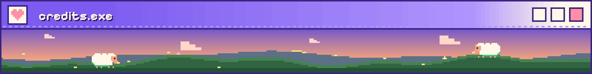

- **Kixki,** the sheep, and the look of the app come from [KixKi Store](https://github.com/KitsukiLove/KixKi-Store), the author's own art.
- **Fonts:** Pixelify Sans and Jersey 10, under the SIL Open Font License 1.1.
- **License:** GNU General Public License v3.0 (see [`LICENSE`](LICENSE)). F-Droid compatible. More in [`docs/THIRD_PARTY.md`](docs/THIRD_PARTY.md).

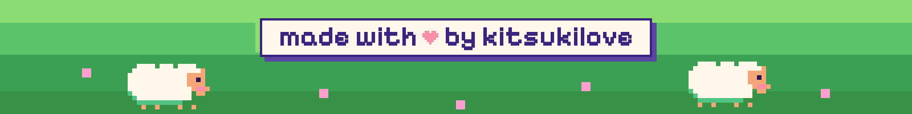

