

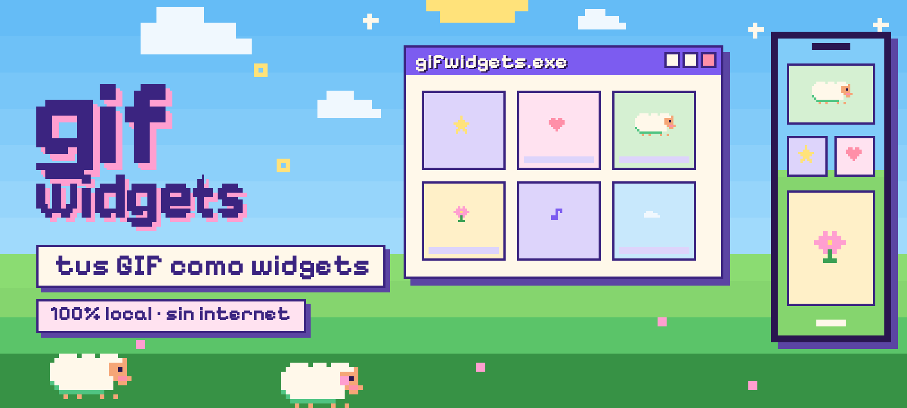

  <b>Convierte tus GIF en widgets animados para la pantalla de inicio de Android.</b> 
  Sin internet, sin cuentas, sin anuncios y con el mínimo gasto de batería.

  <a href="https://github.com/KitsukiLove/GifWidgets/releases/latest"><b>⬇ Descargar el APK</b></a> &nbsp;·&nbsp;
  <a href="README.en.md">English</a>

  <a href="#que-es">Qué es</a> &nbsp;·&nbsp;
  <a href="#galeria">Galería</a> &nbsp;·&nbsp;
  <a href="#instalar">Instalar</a> &nbsp;·&nbsp;
  <a href="#funciones">Funciones</a> &nbsp;·&nbsp;
  <a href="#privacidad">Privacidad</a> &nbsp;·&nbsp;
  <a href="#bateria">Batería</a> &nbsp;·&nbsp;
  <a href="#desarrollo">Desarrollo</a> &nbsp;·&nbsp;
  <a href="#creditos">Créditos</a>

 

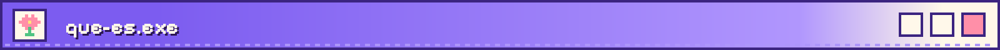

GifWidgets guarda tus GIF en una biblioteca privada y los pone como **widgets animados** en tu pantalla de inicio. Los optimiza al importarlos (fotogramas WebP) para que el widget sea fluido y gaste muy poco, y te deja ajustar cómo se ve cada widget. Está pensada para pixel art y banners con brillos sobre fondo negro, pero sirve para cualquier GIF.

- **Añadir un GIF y listo:** importas, compartes desde otra app o eliges desde un widget, y la app ya lo deja optimizado y con valores por defecto. No hace falta abrir el editor.
- **Widgets que se configuran solos:** en Android 12 o superior el widget aparece ya con tu animación más reciente; lo cambias después si quieres.
- **Tres tamaños** (2×2, 4×2 y 4×4), todos redimensionables, con muchos ajustes por widget.
- **Editor sin IA:** quita fondos, recorta, ordena fotogramas y mide la memoria del widget antes de guardar.
- **Cambio automático de GIF** por widget, cada 15 minutos hasta cada 24 horas.
- **Biblioteca con favoritos y colecciones,** buscador, filtros, vista de lista compacta y copia de seguridad en un ZIP.
- **Batería primero:** el widget lo mueve el launcher, no la app; interruptor universal, pausa con el ahorro de batería y horario nocturno.
- **Privacidad primero:** no tiene permiso de internet. Nada sale de tu móvil.
- **Look de [KixKi Store](https://github.com/KitsukiLove/KixKi-Store):** estilos Pixel y Colina XP, ocho estaciones, música generada en tu teléfono y Kixki, la ovejita guía. En español e inglés.

| De un vistazo | |
|---|---|
| **Android** | 8.0 o superior (API 26). Probada en un Google Pixel 9. |
| **Widgets** | 2×2, 4×2 y 4×4, redimensionables |
| **Permisos** | Ninguno de datos ni de red. Solo los del modo opcional «Máxima calidad» (ver [Privacidad](#privacidad)) |
| **Internet** | No lo usa ni lo declara |
| **Idiomas** | Español (por defecto) e inglés |
| **Licencia** | GNU GPL v3.0, compatible con F-Droid |

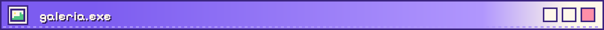

<table>
<tr><td align="center" valign="top" width="25%">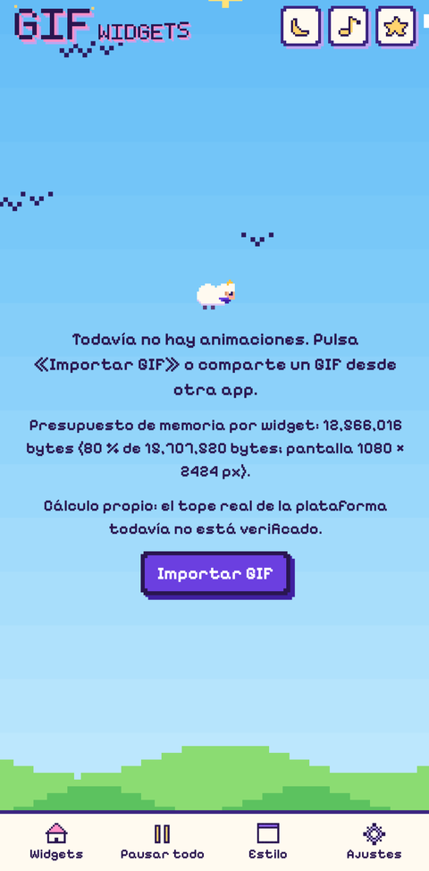</td><td align="center" valign="top" width="25%">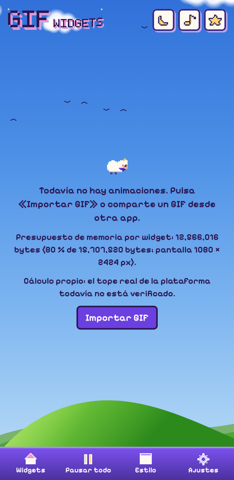</td><td align="center" valign="top" width="25%">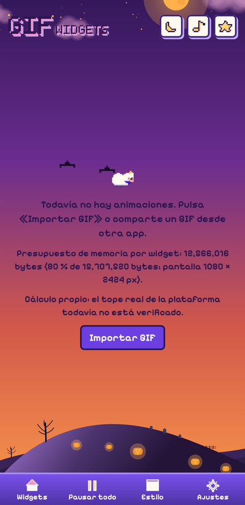</td><td align="center" valign="top" width="25%">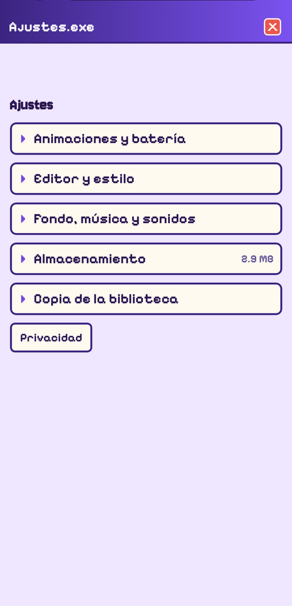</td></tr>
<tr><td align="center">Estilo Pixel</td><td align="center">Colina XP</td><td align="center">Estación Halloween</td><td align="center">Ajustes</td></tr>
</table>

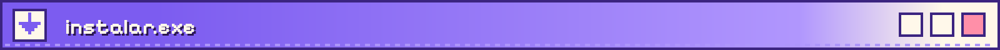

**Descargar**

1. Entra a **[Releases](https://github.com/KitsukiLove/GifWidgets/releases/latest)** desde el navegador de tu móvil.
2. Descarga el archivo `GifWidgets-….apk` de la última versión.
3. Ábrelo. Android te pedirá permitir «instalar apps desconocidas» a tu navegador o a tu app de archivos: acéptalo solo para este paso.
4. Si sale el aviso de **Play Protect** («Se recomienda analizar la app»), no es un error: toca **«Instalar sin analizar»** (el texto pequeño) o **«Analizar app»**, que la manda a revisar y luego te deja instalarla. Sale con cualquier app que no viene de una tienda.
5. Abre GifWidgets.

> **Antes de actualizar:** el APK de cada versión se firma con una clave de depuración distinta, así que Android no deja instalar una versión **encima** de otra: hay que desinstalar la anterior, y eso borra tu biblioteca. Antes, usa **Ajustes → Copia de la biblioteca → Exportar** para guardar un ZIP, y después **Importar** en la versión nueva.

**Primeros pasos**

1. Pulsa **Importar GIF** (o comparte un GIF desde otra app con «Añadir a GifWidgets»).
2. Mantén pulsada la pantalla de inicio → **Widgets** → **GifWidgets** y elige un tamaño. También puedes usar **Añadir a pantalla de inicio** desde la tarjeta de un GIF.
3. Para cambiar su aspecto: mantén pulsado el widget → configurar.

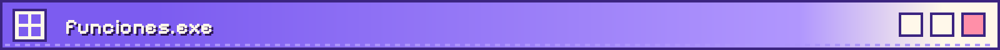

<b>Widgets</b>: tamaños, aspecto y toque

- **Tamaños:** GIF 2×2, GIF 4×2 y GIF 4×4, todos redimensionables.
- **Encuadre:** automático (llena el widget cortando como máximo un tercio de la imagen), ajustar, rellenar o centrar, más zoom.
- **Aspecto:** esquinas, borde y su color, color y opacidad del fondo, relleno interior, brillo y opacidad de la animación, y velocidad.
- **Botón de pausa** opcional, en la esquina que elijas.
- **Al tocar el widget:** alternar la animación, abrir la app, pausar o reanudar **todos** los widgets, pasar a la siguiente animación de la lista o reproducir una vez (experimental).
- **Elegir GIF desde el widget,** con aviso para ponerle nombre antes de añadirlo.
- **Vista a tamaño real** y **copiar el aspecto** de otro widget.
- **Secciones plegables** con botón de restablecer en cada una, y vista previa de lo que se usará (fotogramas, píxeles y velocidad).
- **Pantalla de bloqueo:** los widgets también se ofrecen en la página de widgets de la pantalla de bloqueo (Android 16 QPR2 o superior). Actívala en Ajustes → Pantalla y tacto → Pantalla de bloqueo → «Widgets en la pantalla de bloqueo».
- **Selector de widgets:** en Android 15 o superior la vista previa muestra tu animación más reciente.
- En Android 11 o inferior, al poner un widget se abre su configuración.

<b>Biblioteca</b>: importar y organizar

- **Importar** con el botón, con «Compartir» desde otra app (uno o varios GIF) o con «Elegir GIF» dentro de un widget.
- **Nombre antes de añadir:** la app propone uno a partir del archivo y puedes cambiarlo, o aceptar el mismo para todos en una importación múltiple.
- **Favoritos** (salen primero) y **colecciones** para agrupar, con filtros por favoritos o por colección.
- **Buscador,** orden por más recientes, nombre o tamaño, y filtros por transparencia y por optimizadas.
- **Vista de tarjetas o de lista compacta.**
- **Selección múltiple** para duplicar, borrar o mover a una colección.
- Renombrar, duplicar, borrar (avisa si el GIF está en uso por algún widget) y ver cuánto ocupa cada animación.
- **Límites de importación:** hasta 50 MB, 4096 px por lado (unos 6 millones de píxeles) y 400 fotogramas. El archivo se trata como no confiable y se valida antes de usarlo.

<b>Editor</b>: modo simple y modo Avanzado

- **Siempre se re-edita desde el original,** sin acumular pérdida (si no borras el original en Ajustes).
- **Quitar fondo sin IA:** respetar el GIF, **color clave** con cuentagotas, tolerancia, solo desde los bordes, suavizado y quitar halo; o **negro a transparente** para brillos, estrellas y neón sobre negro.
- **Fotogramas:** empezar y terminar donde quieras, borrar y restaurar fotogramas, ida y vuelta, quedarte con 1 de cada N y elegir el fotograma de reposo.
- **Recorte** manual o automático al contenido visible.
- **Velocidad y tamaño:** fotogramas por segundo, tamaño máximo, píxel nítido (sin suavizar al reducir) y WebP con o sin pérdida.
- **Medidor de memoria del widget** con ajuste automático, y ahorro de memoria (RGB_565) cuando no hay transparencia.
- Vista previa sobre tablero, blanco, negro o un color, y botón para **ver el original**.
- El modo simple muestra lo esencial; **Avanzado** abre el resto.

<b>Cambio automático de GIF</b>

Cada widget puede rotar solo entre las animaciones que elijas en su lista: cada 15 minutos, 30 minutos, 1, 3 o 6 horas, o una vez al día. Usa una sola alarma inexacta (ventana de 15 minutos) que no despierta el móvil y no mantiene ningún servicio vivo. También puedes pasar a la siguiente animación tocando el widget.

<b>Máxima calidad</b> (opcional, por widget)

Reproduce el GIF fotograma a fotograma, a su resolución y velocidad, desde un servicio en primer plano y **sin el límite de memoria de los widgets**. Gasta más batería y muestra una notificación mientras se mueve; se pausa con la pantalla apagada, de noche, con ahorro de batería o al pausar. Si borraste el GIF original, usa los fotogramas guardados. Es lo único que hace que la app pida permisos.

<b>Control de batería y pausa</b>

- **Interruptor universal «Animaciones»:** pausa o reanuda todos los widgets, también desde **Ajustes rápidos** (mosaico) y como acción al tocar un widget.
- **Pausar con el ahorro de batería.**
- **Horario nocturno** configurable; en cada widget puedes encenderlo aunque sea de noche, solo hasta que acabe esa noche.
- Más detalles en [Batería](#bateria).

<b>Copia de seguridad</b>

- **Exportar** la biblioteca (o las animaciones que elijas) a un ZIP, y **Importar** desde uno. Tú decides dónde se guarda el archivo; el ZIP se valida antes de tocar nada.
- **Recordatorio** si pasan 30 días sin copia (y tienes al menos 3 animaciones). Se pospone una semana si lo cierras.
- La copia en la nube de Google está desactivada para la app a propósito.
- Ajustes también muestra la **última copia** y el **almacenamiento** ocupado, con opción de quitar el GIF original de cada animación para ahorrar espacio.

<b>Look KixKi Store</b>: estilos, estaciones, música y Kixki

- **Dos estilos:** **Pixel** y **Colina XP**, y modo claro, oscuro o del sistema.
- **Ocho estaciones** para el fondo: Clásica, Valle, Primavera, Verano, Otoño, Invierno, Halloween y Navidad. «Automática» sigue la fecha. El fondo animado se detiene solo con el ahorro de batería.
- **Música y sonidos** opcionales, creados en tu teléfono (no hay archivos de audio). Solo suenan con la app abierta.
- **Kixki,** la ovejita guía, saluda una vez y luego deja consejos fáciles en una franja que puedes cerrar y reactivar en Ajustes.
- Ventanas «.exe», barra inferior y paisaje de fondo, con el logo que se adapta al tamaño de letra.
- **Idiomas:** español e inglés.

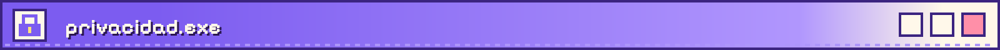

**La app no envía nada a ningún sitio. No puede: no tiene permiso de internet.** Sin cuentas, sin anuncios, sin análisis, sin Google Play services y sin modelos de IA.

| Permiso | Para qué | Cuándo se usa |
|---|---|---|
| `FOREGROUND_SERVICE` y `FOREGROUND_SERVICE_SPECIAL_USE` | Servicio en primer plano del modo «Máxima calidad» | Solo mientras un widget está en ese modo |
| `POST_NOTIFICATIONS` | La notificación de ese servicio (opcional) | Solo en ese modo |

Ninguno da acceso a internet ni a tus datos, y sin el modo «Máxima calidad» no hacen nada. Puedes comprobarlo en la propia app (**Ajustes → Privacidad**) o en Android Studio (`AndroidManifest.xml` → pestaña **Merged Manifest**).

- **Tus archivos:** un GIF entra solo cuando tú lo eliges con el selector del sistema o lo compartes desde otra app. La app no lee tu galería.
- **Dónde viven los datos:** GIF, fotogramas y ajustes están en el almacenamiento **privado** de la app; ninguna otra app puede leerlos, y se borran al desinstalar.
- **Pantalla de bloqueo:** si pones un widget ahí, su animación se ve sin desbloquear el móvil. Elige con cuidado qué GIF muestras.
- **Sonido:** música y sonidos se generan en tu móvil; la app no usa el micrófono.
- **Componentes:** bibliotecas de Android y Jetpack, y Kotlin. El decodificador de GIF y la conversión a WebP son propios.

Detalle completo en [`docs/PRIVACY.md`](docs/PRIVACY.md).

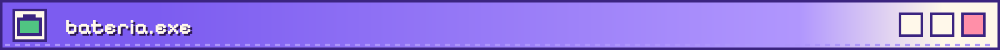

La idea central: **mientras el widget se mueve, la app no está viva.** Lo anima el launcher con un `ViewFlipper`, así que la app no gasta CPU ni mantiene procesos. Los widgets usan `RemoteViews` clásicos (no Glance) justo por eso.

| Mecanismo | Cómo funciona |
|---|---|
| Sin procesos permanentes | Solo trabajos cortos al tocar, redimensionar o añadir un widget |
| Interruptor universal | Pausa todo a la vez; también en Ajustes rápidos |
| Ahorro de batería | Los widgets se quedan quietos mientras esté activo |
| Horario nocturno | Una sola alarma inexacta que no despierta el móvil |
| Cambio automático de GIF | Una sola alarma inexacta con ventana de 15 minutos |
| Memoria | Presupuesto por widget; si no cabe, se reduce con aviso en vez de fallar |
| «Máxima calidad» | Es la excepción: gasta más batería, por eso es opcional y por widget |

Para medirlo en tu móvil con `adb`: [`docs/BATTERY_TESTING.md`](docs/BATTERY_TESTING.md).

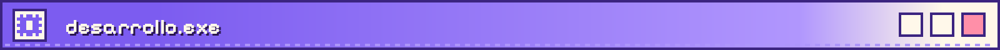

**Stack:** Kotlin, Jetpack Compose con Material 3, `RemoteViews` + `ViewFlipper` para los widgets, un solo módulo `app`, minSdk 26 y targetSdk 36. Package: `app.gifwidgets`.

<b>Compilar en Android Studio</b>

1. Abre la carpeta del proyecto con Android Studio (Windows, Mac o Linux).
2. Deja que sincronice Gradle y pulsa **Run ▶** con el móvil conectado (depuración USB).

<b>Versión final (release) y APK</b>

`app/build.gradle.kts` ya trae el release con R8, recursos reducidos, solo español e inglés y firma de depuración (uso personal, no es firma de tienda).

- En Android Studio: **Build Variants → release**, luego **Build → Generate App Bundles or APKs → Generate APKs**.
- En terminal: `./gradlew assembleRelease` (`gradlew.bat assembleRelease` en Windows). El APK queda en `app/build/outputs/apk/release/`.
- Prueba en esa versión la biblioteca, el editor, un widget y Ajustes: R8 puede romper cosas que en debug funcionan.

**Con GitHub Actions:** el flujo [`build-apk.yml`](.github/workflows/build-apk.yml) compila el APK en los servidores de GitHub.
- **Con versión:** crea una etiqueta (`git tag v1.0 && git push --tags`) y el APK aparece en **Releases**.
- **A mano:** pestaña **Actions → Build APK → Run workflow**; el APK queda como *artifact*.

<b>Pruebas</b>

- Lógica pura (control, ajustes del widget, ZIP, GIF, edición, biblioteca, rotación…): `./gradlew testDebugUnitTest`.
- Lista de pruebas a mano en el teléfono: [`docs/PRUEBAS.md`](docs/PRUEBAS.md).
- Medición de batería: [`docs/BATTERY_TESTING.md`](docs/BATTERY_TESTING.md).

<b>Estructura del proyecto</b>

Código en `app/src/main/kotlin/app/gifwidgets/`. Textos en `values/` (español) y `values-en/` (inglés).

| Carpeta | Qué hay |
|---|---|
| `gif/` | Decodificador de GIF propio |
| `library/` | Biblioteca, importación, favoritos y colecciones |
| `edit/` | Editor y escritura del WebP optimizado |
| `memory/` | Cálculo del presupuesto de memoria por widget |
| `widget/` | Widgets, configuración, rotación automática y «Máxima calidad» |
| `control/` | Interruptor universal, ahorro de batería, horario nocturno y estaciones |
| `backup/` | Exportar e importar el ZIP y el recordatorio |
| `audio/` | Música y sonidos generados |
| `ui/` | Pantallas y el diseño (Pixel y Colina XP) |

<b>Documentos</b>

| Archivo | Contenido |
|---|---|
| [`docs/PRIVACY.md`](docs/PRIVACY.md) | Política de privacidad completa |
| [`docs/BATTERY_TESTING.md`](docs/BATTERY_TESTING.md) | Cómo medir la batería |
| [`docs/PRUEBAS.md`](docs/PRUEBAS.md) | Lista de pruebas manuales |
| [`docs/DECISIONS.md`](docs/DECISIONS.md) | Decisiones de diseño y lista VERIFY |
| [`docs/THIRD_PARTY.md`](docs/THIRD_PARTY.md) | Bibliotecas, fuentes y recursos |
| [`LICENSE`](LICENSE) | GNU GPL v3.0 |

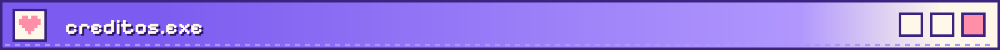

- **Kixki,** la ovejita, y el look de la app vienen de [KixKi Store](https://github.com/KitsukiLove/KixKi-Store), arte de la propia autora.
- **Fuentes:** Pixelify Sans y Jersey 10, bajo SIL Open Font License 1.1.
- **Licencia:** GNU General Public License v3.0 (ver [`LICENSE`](LICENSE)). Compatible con F-Droid. Más en [`docs/THIRD_PARTY.md`](docs/THIRD_PARTY.md).

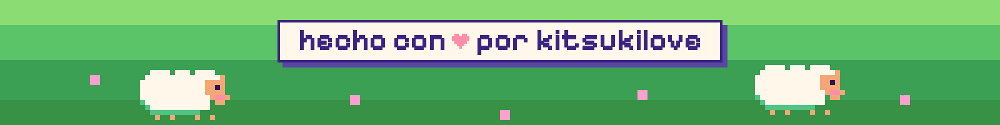

